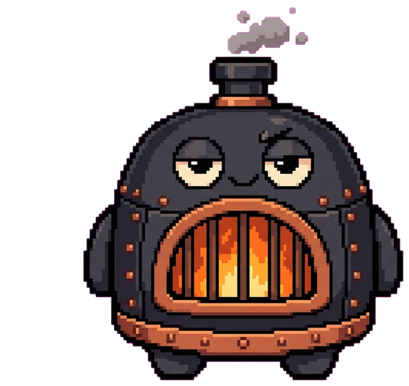

# Part 01: Token Incinerator

Type anything. It gets chopped into tokens and fed to **Gerald**, a smug cast-iron furnace. You get a receipt. Nothing useful happens.



## Run it

It's one HTML file with no build step and no API key. Just open `index.html` in a browser.

If your browser blocks the images when opening the file directly, serve the folder instead:

```bash
python3 -m http.server 8000
```

Then go to http://localhost:8000.

## Things to try

- Click a preset (startup pitch, terms & conditions, LinkedIn post…) and hit **BURN IT**, or press ⌘/Ctrl + Enter.
- Poke Gerald.
- Press **burn this entire webpage**.
- Turn on sound. The crackles are synthesized live, so there are no audio files.

## How it works

- **Tokenizer:** vibes-based. Words, numbers and punctuation get split roughly the way a GPT-style tokenizer would, and long words get chopped into 4-letter chunks. It isn't accurate, and it doesn't need to be.
- **Pricing:** $15 per million tokens, our premium waste tier. Lifetime totals stay in your browser's localStorage.
- **Gerald:** three AI-generated pixel-art sprites (idle, chomping, satisfied) in `assets/`. The fire, embers and flying tokens are plain canvas + DOM animation.
